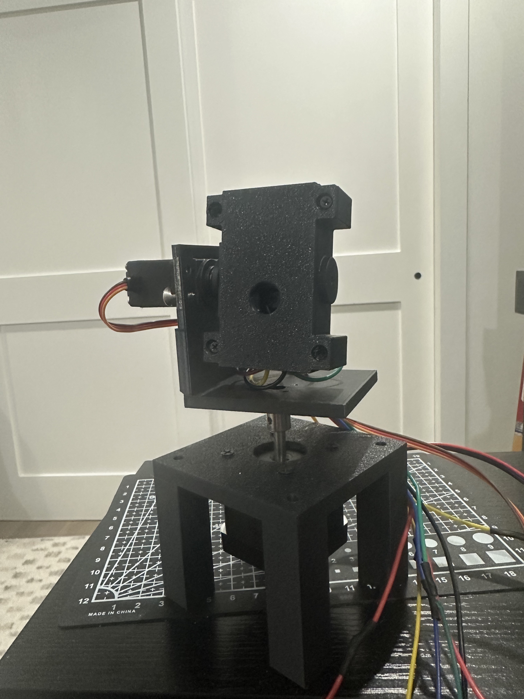
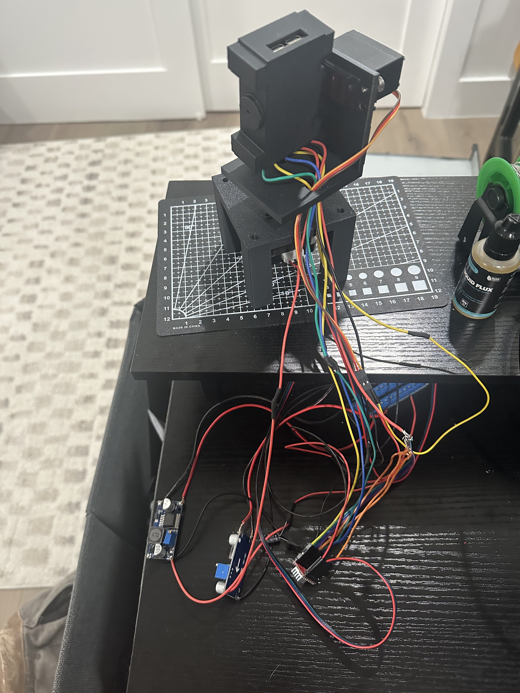
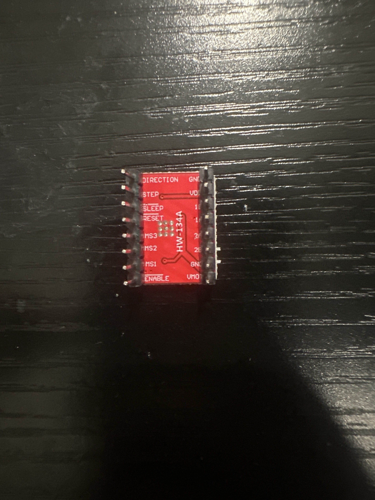

# ESPCamGimbal — ESP32-S3 hand-tracking camera

An embedded robotics project combining an ESP32-S3 camera, a NEMA 17 pan motor,
an MG996R tilt servo, and a Python computer-vision application. Video streams
over Wi-Fi while the desktop detects a selected hand and the firmware controls
camera motion.

## The build



Camera head above the pan base, with the tilt servo mounted beside the head.
See the [build photo gallery](docs/BUILD_PHOTOS.md) for side views, the external
electronics, and both sides of the stepper-driver module.

## Project highlights

- **Embedded C / ESP-IDF:** camera capture, TCP streaming, and a 100 Hz motion loop.
- **Python / OpenCV / MediaPipe:** hand detection, hand selection, gesture release,
  and camera calibration.
- **Predictive control:** capture timestamps and axis history compensate for motion
  during video latency; an alpha-beta filter estimates target position and speed.
- **Motor control:** hardware-generated step pulses and servo PWM, configurable
  travel limits, and a command-loss timeout.
- **Protocol validation:** host tests cover tracking mathematics, TCP framing,
  calibration, hand locking, and firmware/desktop configuration consistency.

Video uses TCP port 5000; commands and board status use port 5001. Pan position
is estimated from commanded motion, so missed motor steps require recentering.
The calibration file describes this particular camera and should be recalibrated
for another build.

## Getting started

1. Verify the physical connections and power-supply rating for your own build;
   the hardware notes below record the current build description.
2. Copy `main/include/wifi_credentials.h.example` to
   `main/include/wifi_credentials.h` and enter your own network details.
3. Install ESP-IDF v5.5.4 and set `GIMBAL_IDF_PATH` to its checkout directory.
   Run `./idf.sh set-target esp32s3`, then `./idf.sh build`.
4. Flash the board, install `desktop/requirements.txt` in a Python virtual
   environment, and obtain the hand-landmarker model as described below.
5. Run `python desktop/tracker.py espgimbal.local`; show a hand and press **r**.

The firmware source, desktop application, credential template, and dependency
lockfile are included. Local credentials, generated builds, Python environments,
and third-party model weights are excluded from Git.

The following guide contains the hardware notes, tuning instructions, and
commands for running the existing tests. Performance figures describe the
original build or simulations, rather than guarantees for other hardware.

---

A NEMA 17 pan base and an MG996R tilt joint carrying an ESP32-S3-CAM. The board
streams JPEG over Wi-Fi to your computer; the computer finds your hand and tells
the board where it is. **Show your hand and press r: the gimbal locks onto that
hand and follows it, ignoring any other. Hold a stop sign for three seconds and
it lets go.**

The streaming path is taken unchanged from the `optimizedcam` project next door,
which already sustains about 22 fps at VGA on this hardware. Tracking rides on a
second socket and a second task so it can never slow the video down.

---

## Hardware and wiring status

These notes record the current hardware description provided by the builder.
The power setup and component values below are confirmed by the builder. The
supplied photos show the assembly, external electronics, and driver pin labels.
The signal assignments are verified from the firmware; the installed wires
have not yet been traced terminal by terminal.



The two **LM2596 DC–DC buck converters** are visible below the gimbal. Both
are fed through a power rail from a **12 V / 3 A bench supply**.

| Item | Current build description |
|---|---|
| Power distribution | Power rail feeds two separate **LM2596 DC–DC buck converters** |
| Servo branch | One LM2596 set to **6 V**, supplying the servo |
| ESP32-S3 branch | Second LM2596 set to **5 V**, supplying the ESP32-S3 |
| Stepper-driver capacitor | **330 µF electrolytic** at the driver's motor supply |
| Servo capacitor | **470 µF electrolytic** at the servo supply |
| Microstepping | **1/16**, reported by the builder as configured by tying the selection wires together |
| Input supply | **12 V / 3 A bench supply**, confirmed by the builder |
| Stepper-driver module | PCB marked **HW-134A** in the pin-side photo; believed to be A4988, with exact IC identification still unconfirmed |

Both the firmware's `GIMBAL_STEPPER_MICROSTEPS` and the desktop's `MICROSTEPS`
are already **16**, matching the reported microstepping setting. This verifies
software consistency; it does not verify which physical selection pins are tied
or what voltage they are tied to.

### Signal assignments verified from the code

The pin definitions in [`main/include/gimbal_pins.h`](main/include/gimbal_pins.h)
are used by `main/stepper_driver.c` and `main/servo_driver.c`:

| ESP32-S3 GPIO | Expected destination |
|---|---|
| **1** | Stepper-driver STEP |
| **2** | Stepper-driver DIRECTION / DIR |
| **42** | Stepper-driver ENABLE |
| **41** | Servo signal |

The code verifies the assigned GPIO numbers and the software's 1/16 step scaling.
It cannot detect which terminals the physical wires reach, the driver logic and
motor-supply connections, shared grounds, MS1/MS2/MS3 connections, or capacitor
polarity and voltage ratings. Those details require tracing the installed wires
or recording the actual terminal connections. The photos show cable routing but
do not make every connection visible.

### Driver pin labels



The photographed carrier is marked **HW-134A**. The pin side labels the control
connections as DIRECTION, STEP, SLEEP, RESET, MS3, MS2, MS1, and ENABLE. These
are the printed module labels; the photo shows the loose module, not the
installed microstepping connections.

---

## How it works

```text
camera ─ DMA ─ camera task (CPU 1) ─ 2 PSRAM buffers ─ latest-frame mailbox
                                                     ─ TCP task (CPU 0) ─┐
                                                                port 5000│
   computer ◄──────────────────────────────── JPEG ──────────────────────┘
      │
      ├─ MediaPipe: where are the hands, which is locked, is it a stop sign?
      │
      └─ port 5001 ─► control task (CPU 0) ─► motion loop (CPU 1, 100 Hz)
                                               ├─ stepper: LEDC timer 1
                                               └─ servo:   LEDC timer 2
```

**The vision runs on the computer, not the board.** Landmark inference needs far
more compute than the ESP32-S3 has spare while it is also capturing and
streaming, and the computer is receiving every frame anyway. The board never
sees an image of your hand — only "the hand is this far off centre".

**The board decides how to move.** The desktop reports position; gain, speed
ceiling, acceleration, soft limits and the failsafe all live in
`gimbal_control.c`. That split is deliberate: a late or dropped Wi-Fi packet
degrades tracking accuracy, but it can never turn into a violent motion command.
If commands stop arriving for 400 ms the pan axis ramps to a stop on its own.

**Tracking is predictive.** A frame is 60-150 ms old by the time it steers, and
the gimbal has kept moving since. Steering on "the hand is 10 degrees right"
from wherever the camera points *now* applies that correction twice, which is
why a plain proportional loop hunts as soon as its gain goes up. So the desktop
sends each hand position as an angle, together with the capture timestamp the
board put in that frame's header. The board keeps a one-second history of where
both axes pointed, turns every measurement into an absolute angle using where
the camera pointed when that frame was exposed, filters those angles (an
alpha-beta filter that also estimates the hand's speed), predicts to the present
and drives straight there on a braking curve the stepper can always stop
within. The gimbal's own motion drops out of the loop.

In a closed-loop simulation of this rig, a 20 degree jump settles in about
540 ms with no overshoot (the proportional loop: 970 ms and 5 degrees), a
40 deg/s sweep is followed within 4.6 degrees RMS (was 11), and with 80 ms of
extra Wi-Fi delay it still settles without overshoot where the old loop swung
13 degrees past. The same firmware, closed around its own position estimate with
a virtual hand, settled a 15 degree step in 345 ms. The overlay shows
`predictive` while it is following and how old the board's picture of the hand
is. The maths lives in `main/target_tracker.c`, free of ESP-IDF, with host tests
in `test/`.

**Pulses are generated in hardware.** The step train is an LEDC timer, not a
GPIO toggled from an interrupt, so commanding a new speed costs one register
write and the pulses themselves cost no CPU time at all — nothing competes with
the camera or the radio. The trade-off is that the hardware does not report how
many pulses it emitted, so the pan position is integrated from the commanded
rate. It is accurate enough for soft limits; it is not an encoder, and a skipped
step is invisible to it. Press **c** to re-home if it drifts.

The motion loop runs at 100 Hz against a ~20 fps vision rate, so movement is
interpolated smoothly between detections instead of stepping once per frame.

---

## 1. Wi-Fi credentials

```bash
cp main/include/wifi_credentials.h.example main/include/wifi_credentials.h
```

Then edit it. `main/include/wifi_credentials.h` is in
[`.gitignore`](.gitignore) — only the `.example` template is tracked, so real
credentials cannot reach a commit. The firmware logs the *length* of the
passphrase at boot so you can spot a typo, never its contents.

Use a 2.4 GHz network; the ESP32-S3 has no 5 GHz radio.

## 2. Build and flash

Use ESP-IDF v5.5.4. For a standalone checkout, set the path before building:

```bash
export GIMBAL_IDF_PATH="/path/to/esp-idf"
```

`idf.sh` also detects `.tools/esp-idf-v5.5.4` inside the project, or the same
toolchain in a neighbouring `optimizedcam` checkout when available.

```bash
./idf.sh set-target esp32s3
./idf.sh build
./idf.sh -p /dev/cu.usbmodemXXXX flash monitor
```

Find the port with `ls /dev/cu.*`. Both USB-C ports can flash this board: the
native OTG port appears as `/dev/cu.usbmodem…`, the CH340C UART port as
`/dev/cu.wchusbserial…`. To force download mode: hold **BOOT**, tap **RST**,
release **BOOT**.

USB is only needed for flashing and the serial console. Once flashed the board
runs from flash on power-up, so it can live on a bench supply with no computer
attached — see **Running untethered** below.

A healthy boot reports all of these:

```text
Pan axis ready on STEP=1 DIR=2 EN=42, 3200 steps/rev, 25-1350 steps/s
Tilt axis ready on GPIO 41, centred at 90 deg, travel 50-130 deg
Gimbal control loop is running on CPU 1 at 100 Hz
Connected. Board IP address: 192.168.x.x
Camera ready: PID=0x3660, JPEG quality=16, buffers=2, rotated=yes
Camera task is running on CPU 1
Network task is running on CPU 0
Startup complete: video on port 5000, tracking on port 5001
```

If the camera fails to initialise, check the ribbon seating and then confirm
nothing in `gimbal_pins.h` was moved onto a camera pin.

## 3. Run the tracker

```bash
python3 -m venv .venv
source .venv/bin/activate
python -m pip install -r desktop/requirements.txt
python desktop/tracker.py 192.168.x.x
```

**The hand model is a separate file.** Current MediaPipe builds have dropped the
old `mp.solutions.hands` API completely, so this project uses the Tasks API,
which keeps its weights outside the wheel. Put `hand_landmarker.task` (7.8 MB,
from [the MediaPipe hand landmarker
page](https://ai.google.dev/edge/mediapipe/solutions/vision/hand_landmarker)) at
`desktop/models/hand_landmarker.task`, or point `HAND_LANDMARKER_MODEL` at a
copy you already have. It is gitignored rather than committed. Without it the
tracker stops at startup with a message saying exactly where to put it; the
stream still works with `--no-track`.

| Key | Action |
|---|---|
| **r** | lock onto the hand nearest the centre / release it |
| **space** | arm / disarm tracking (software safety) |
| **m** | motors off / on |
| **c** | recentre both axes to their power-on position |
| **arrow keys** | jog pan / tilt by hand; hold to move, release to stop |
| **p** / **t** | reverse pan / tilt direction live, without reflashing |
| **[** / **]** | shrink / grow the working area |
| **{** / **}** | shrink / grow its width alone |
| **q** or **Esc** | quit |

### The working area

Hand detection uses the whole frame by default, and nothing on screen is
dimmed.

That was not always so. This build's first camera threw an image circle too
small for its sensor, so the corners of every frame were black and a hand could
never be seen there. The tracker worked inside a centred 0.80 x 0.80 box and
dimmed the rest. With the camera fixed, the corners show the scene, so the box
now defaults to the full frame.

If a camera does leave the corners dark, the box is still available. Press **[**
and **]** until it just clears them, or start with it set:

```bash
python desktop/tracker.py espgimbal.local --roi 0.80,0.80
```

Detection then runs on the crop, which keeps black borders out of the model's
input and makes the hand larger relative to what it does see. The box does not
change how fast the gimbal follows: predictive tracking steers by angle, which
comes from the calibrated field of view, not from how far the hand is toward
the box's edge.

### Locking onto a hand, and letting go

With your hand in view, press **r**. The gimbal locks onto the hand nearest the
centre of the picture and follows it in any pose: fist, open, pointing. Every
other hand is ignored and drawn in grey, whether it is your other hand or
someone walking past.

To stop, hold a **stop sign** still at the camera for three seconds: palm open,
all four fingers straight and pointing up, thumb out. A ring around the hand
fills while you hold it, and when it completes the gimbal lets go and holds
still. Press **r** to lock on again. Pressing **r** while a hand is being
followed also lets go, straight away.

The sign has to be held *in place* because a raised open hand is exactly the
shape of a stop sign, and it is also how most people hold a hand up to be
followed. Moving it around restarts the count, so waving an open hand about
never lets go; keeping one still for three seconds does.

The lock recognises your hand by where it is in the room, not where it is in
the picture. When the gimbal swings toward your hand, the hand races across the
picture even though it has not moved, so matching by picture position used to
lose it exactly when the gimbal was busy following. The tracker now takes the
gimbal's own motion out using the angles the board reports back, the same way
the board does when it steers.

If the locked hand is missed for a frame -- motion blur, an awkward pose -- the
gimbal keeps going toward where it was heading instead of braking, and the
tracker looks again, zoomed in around where the hand should be. Across the
whole frame, a palm 1.2 m away is only about a dozen pixels long to MediaPipe's
palm detector; in the zoomed crop it is two to three times larger.

If the locked hand leaves the picture, the gimbal holds. It picks the hand up
again only near where it vanished, never a hand elsewhere in the room; if you
come back somewhere else, press **r**. Another hand that was in view at the same
time as yours is never taken for it, even while yours is out of sight right
beside it.

The overlay shows the stream statistics, whether a hand is locked and followed,
how often hands are being found (`vision: hands found in N% of frames, locked
hand in N%`), how far through a stop sign you are, and what the board reports
back: pan position and rate, tilt angle, and whether the failsafe has engaged.

`python desktop/tracker.py 192.168.x.x --no-track` watches the stream without
ever connecting to the control port.

### Calibrate the camera (once)

Predictive tracking converts a position in the picture into an angle, so it
needs the lens's real field of view. With motor power on and the camera facing
a still, detailed scene -- a bookshelf, not a blank wall, with nobody moving:

```bash
python desktop/calibrate_fov.py espgimbal.local
```

It turns each axis a few degrees at a time, measures how far the picture moves
by phase correlation, and writes `desktop/camera_calibration.json`, which the
tracker loads at startup. It also checks that both axes turn the right way and
refuses to save if one is reversed: a reversed axis makes predictive tracking
run away. Without a calibration file the tracker uses an early measurement from
this rig, 63.7 x 50.0 degrees.

## 4. Running untethered

The board advertises itself over mDNS, so nothing has to be read off a serial
console to find it:

```bash
python desktop/tracker.py espgimbal.local
```

The hostname is `MDNS_HOSTNAME` in `app_config.h`. If mDNS fails to start the
board is still reachable by IP and the stream comes up regardless — it is logged
as a warning, never a failure.

`tracker.py` resolves IPv4 only, deliberately. `socket.create_connection()` asks
for A *and* AAAA records; the board answers only A, so an `espgimbal.local`
lookup sits waiting out the AAAA timeout — measured at **5.0 s** on macOS here,
against a 3 s connect timeout. The result looked exactly like an unreachable
board. Resolving IPv4 explicitly takes 0.01 s.

### Powering it

A **12 V / 3 A bench supply** feeds the power rail. Two **LM2596 DC–DC buck
converters** provide separate branches: **5 V to the ESP32-S3** and **6 V to the
servo**. The build uses a **330 µF electrolytic capacitor at the stepper-driver
motor supply** and a **470 µF electrolytic capacitor at the servo supply**.
See [Hardware and wiring status](#hardware-and-wiring-status) for the firmware
signal assignments and the physical connections still to be recorded.

## 5. Driving it by hand, and checking the axes

Two tools that need no hand detection, for when an axis is misbehaving and the
vision pipeline would only add variables.

```bash
python desktop/jog.py espgimbal.local        # arrow keys, no camera window
python desktop/axis_selftest.py espgimbal.local
```

`jog.py` drives either axis from the terminal: arrows move, `,` and `.` change
speed, `c` recentres, `m` cuts the motors. Releasing the keys stops the gimbal
on its own — a jog expires shortly after the last keypress, and the board's
failsafe halts the axes 400 ms after commands stop arriving.

It is also the quickest way to settle the direction flags. Press the **right**
arrow: that commands exactly what the gimbal does when a hand is right of
centre. If the camera turns left, set `GIMBAL_PAN_INVERT` to 1 — or press **p**
in the tracker to try it without reflashing first.

### axis_selftest.py

Decides whether each axis physically moves, with nobody watching.

The camera rides on both axes, so if an axis moves the picture changes. Earlier
attempts compared a frame before a move with one after, and that failed badly on
this build: a large move leaves no overlapping scene, and the lens vignette is a
fixed pattern on the *sensor* that correlation locks onto instead — it reported
"0.0 px shift, 0.92 confidence" while the camera was swinging 160 degrees.

So this measures something much harder to fool. It samples frame-to-frame change
while an axis is idle to establish a noise floor, then samples the same quantity
while the axis is commanded to move. A moving camera makes consecutive frames
differ several times more than sensor noise does. It needs no scene texture, no
overlap and no correlation — only that something in view changes.

```text
  idle frame-to-frame change: 0.931 grey levels
  PAN (stepper)   +410 steps (+92 deg)   2.801  (3.0x floor)  MOVES
  TILT (servo)    90 -> 110 deg          0.502  (0.5x floor)  NOT MOVING
```

## 6. Testing without hardware

`desktop/fake_board.py` speaks both protocols and runs a simplified copy of the
motion model, so the whole desktop side can be developed with no board present:

```bash
python desktop/fake_board.py
python desktop/tracker.py 127.0.0.1
```

Unit tests need neither board nor camera:

```bash
cd desktop && python3 -m unittest test_control_protocol test_protocol test_calibration test_hand_lock test_camera_pose test_gimbal_config -v
```

The tracking maths has its own host tests, built with the Mac's compiler:

```bash
cc -std=c11 -Wall -Wextra -Imain/include main/target_tracker.c test/target_tracker_test.c -lm -o /tmp/target_tracker_test && /tmp/target_tracker_test
```

---

## Tuning

Everything worth changing is in
[`main/include/gimbal_config.h`](main/include/gimbal_config.h). Change one thing
at a time and watch the overlay. A few of those values -- motor geometry, gain,
deadband, tilt direction, exposure delay -- are mirrored in
`desktop/gimbal_config.py`; `test_gimbal_config.py` fails until the two agree.

**Following a hand is governed by the "predictive tracking" section.** Each
setting there says what it trades off, with the simulated numbers behind the
chosen value. The proportional settings further up still drive the arrow-key
jog and the test tools. Run `calibrate_fov.py` before tuning anything: with a
wrong field of view every move lands short or long, and no gain fixes that.

**The gimbal moves away from your hand instead of toward it.** Set
`GIMBAL_PAN_INVERT` (or `GIMBAL_TILT_INVERT`) to 1. Which way is "forward"
depends on how you wired the coils and mounted the servo horn, so one of the two
is a coin flip.

**It overshoots and hunts around your hand.** Lower
`GIMBAL_PAN_GAIN_STEPS_PER_S`. Raise it for snappier tracking.

**The motor buzzes but does not turn, or loses position on fast moves.** The
motor is skipping. Lower `GIMBAL_PAN_ACCEL_STEPS_PER_S2`, then
`GIMBAL_PAN_MAX_STEP_RATE`, and check the driver's current limit.

**It twitches when your hand is nearly centred.** Raise
`GIMBAL_ERROR_DEADBAND`. Note that the effective deadband is slightly wider than
this value: just outside the band the commanded rate is below
`GIMBAL_PAN_MIN_STEP_RATE`, so no pulses are emitted at all. That is intentional
— it is what stops the axis dithering — and it works out to about 8–9 % of a
half-frame with the stock numbers.

**The stop sign is missed, or lets go by accident.** `is_stop_sign()` in
`desktop/hand_tracker.py` wants all four fingers straight and pointing up, the
hand within 45 degrees of upright and the thumb out; `STOP_HOLD_S` in
`desktop/hand_lock.py` is how long it must be held and `STOP_MAX_DRIFT_PALMS`
how still. Face your palm at the camera: side-on hands are ambiguous to any
landmark model. If holding an open hand still to be followed keeps letting go,
the next step is to require the fingers held together, which a relaxed open
hand does not do.

**It loses your hand, or takes someone else's.** First read the `vision:` line.
A low `hands found` means MediaPipe is not seeing the hand at all (see the next
entry). A high `hands found` with a low `locked hand` means the lock is refusing
it. `desktop/hand_lock.py` matches the locked hand by its angle in the room,
measured in palm lengths from where it was last seen. `MATCH_DISTANCE_PALMS`
sets how far it may move between frames and `MAX_SEARCH_PALMS` how far away a
vanished hand may reappear and still count. Size and MediaPipe's left/right
call only break ties: the left/right call flips when a hand turns over, and as
a hard rule it used to lose the hand for good. Run `calibrate_fov.py` if you
have not: the room angles come from the calibrated field of view.

**It does not pick your hand up.** MediaPipe's palm detector works best on an
open palm facing the camera, and finds hands less often the smaller they are:
at two metres a palm is about eight pixels long in the detector's input. Come
closer, or show an open palm to start, then any pose is followed. A washed-out
picture also costs detections -- this camera's view of a white room averages
160 of 255 -- so `set_brightness(sensor, 1)` in `main/camera_service.c` is worth
trying at 0.

**Tracking is laggy.** Check `vision N ms old` on the gimbal line first: that is
capture to arrival on the board, normally 60-100 ms. Hundreds of milliseconds
means Wi-Fi or a stalled desktop. A climbing `merged by camera` count means the
camera is gluing frames together and delivering fewer of them; reseat the
ribbon and check the servo supply. Then check the `recv` and `show` fps. If `show`
is well below `recv`, the computer is the bottleneck. Shrinking the picture
does not help: MediaPipe resizes to its own fixed input, and 320 and 640 pixels
wide both measured 13.7 ms here. Check `sysctl vm.swapusage` instead -- an
8 GB Mac that is swapping stalls everything. If `recv` itself is low, it is the
radio: raise `CAMERA_JPEG_QUALITY` toward 18.

**The camera image is upside down.** Set `CAMERA_ROTATE_180` to 0 in
`app_config.h` if you remounted the module upright. The tracker measures error
on the final image, so its sign conventions are unaffected either way.

Camera and radio settings inherited from `optimizedcam` are worth leaving alone.
In particular `CAMERA_XCLK_HZ` stays at 16 MHz: at the more common 20 MHz this
board's camera clock polluted its own 2.4 GHz path and the stream collapsed from
27 fps to below 1 fps after a few seconds.

---

## Code map

**Firmware**

| File | Role |
|---|---|
| `main/gimbal_control.c` | the 100 Hz motion loop: predictive following, jog, slew limit, soft limits, failsafe |
| `main/target_tracker.c` | axis history, hand-angle filter and braking curve; no ESP-IDF, host-tested |
| `main/stepper_driver.c` | NEMA 17 step/dir via LEDC, with the position estimate |
| `main/servo_driver.c` | MG996R angle → pulse width, clamped to real travel |
| `main/control_server.c` | TCP port 5001, command in / status out |
| `main/stream_server.c` | capture and TCP video tasks — **unchanged from optimizedcam** |
| `main/camera_service.c` | sensor and PSRAM setup |
| `main/wifi_manager.c` | connection, reconnection, power-save disabled |
| `main/include/gimbal_pins.h` | the four gimbal pins, plus the compile-time guard |
| `main/include/gimbal_config.h` | everything you would tune |

**Desktop**

| File | Role |
|---|---|
| `desktop/tracker.py` | the application: network thread, display, control thread |
| `desktop/hand_tracker.py` | MediaPipe wrapper, hand geometry, stop sign |
| `desktop/hand_lock.py` | which hand is followed, and the stop sign hold |
| `desktop/camera_pose.py` | where the camera pointed when each frame was exposed |
| `desktop/camera_model.py` | picture position to angle, from the calibration file |
| `desktop/gimbal_config.py` | the values from `gimbal_config.h` the desktop needs; a test keeps them in step |
| `desktop/calibrate_fov.py` | measures the field of view and checks axis directions |
| `desktop/control_protocol.py` | port 5001 wire format |
| `desktop/protocol.py` | port 5000 wire format |
| `desktop/jog.py` | manual arrow-key control, no camera needed |
| `desktop/axis_selftest.py` | decides whether each axis physically moves |
| `desktop/motor_test.py` | slow repeated sweeps of one axis, to watch it |
| `desktop/fake_board.py` | board simulator for working without hardware |

Both protocols are fixed-size, magic-validated and in network byte order. The
control protocol is version 2, which added measurements; a version 1 desktop or
board is refused rather than having an angle misread as a speed. The
struct sizes are asserted at compile time in C and checked again in the Python
tests, so the two halves cannot drift apart silently.
