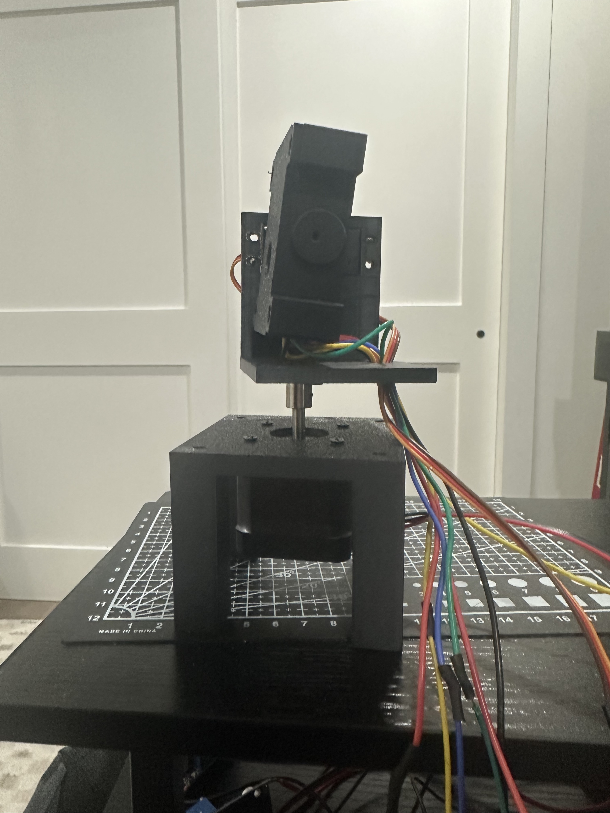
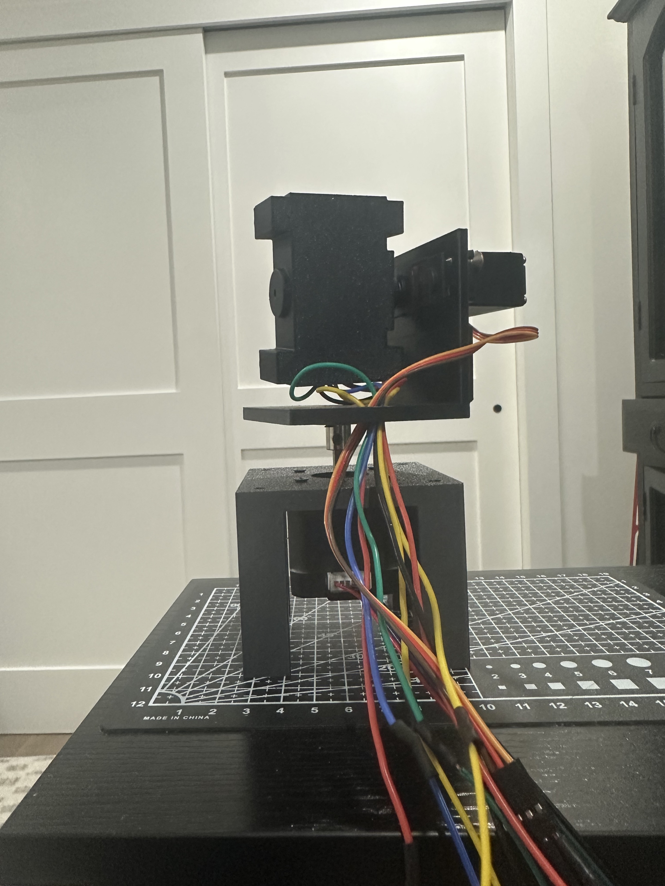
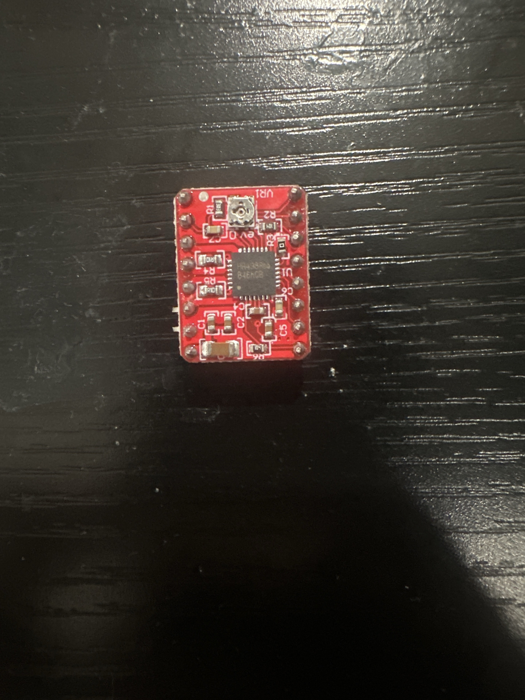

# Build photos

Six photos supplied by the builder. They show the assembled hardware and
driver module. Power readings, capacitor markings, and exact installed
pin-to-pin connections are not established by these photos.

[Return to the project README](../README.md)

## Electronics overview

Assembly and external cable bundle, with two buck-converter boards below the gimbal.

## Assembled front view

Camera opening, printed head and frame, side-mounted tilt servo, and pan base.

## Side view

Camera-head support, shaft coupling, and cable exit below the head.

## Rear and servo-side view

Tilt-servo mounting and cable routing down beside the pan base.

## Driver component side

Component side of the red stepper-driver module, including the IC and adjustment potentiometer.

## Driver pin-label side

PCB marking HW-134A and the printed control, power, and motor-terminal labels.
